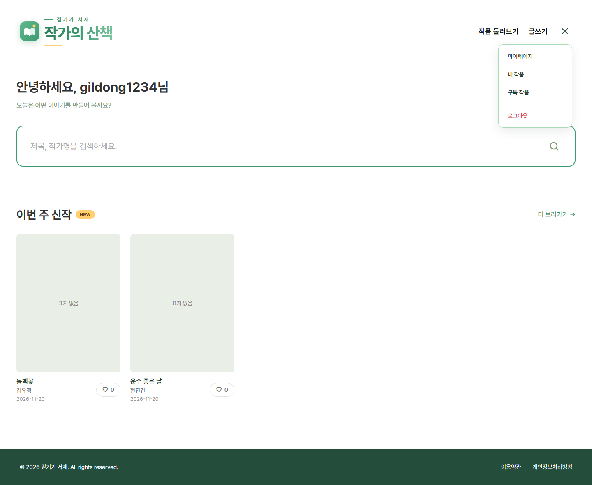
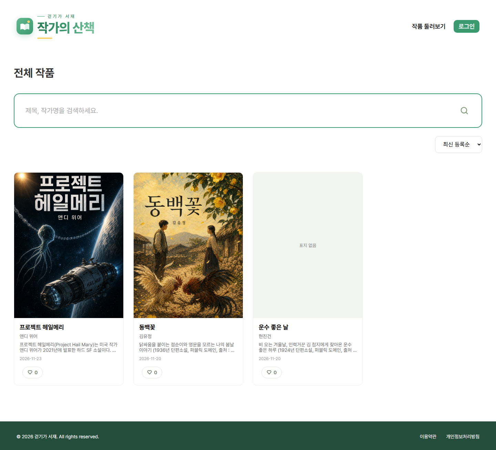
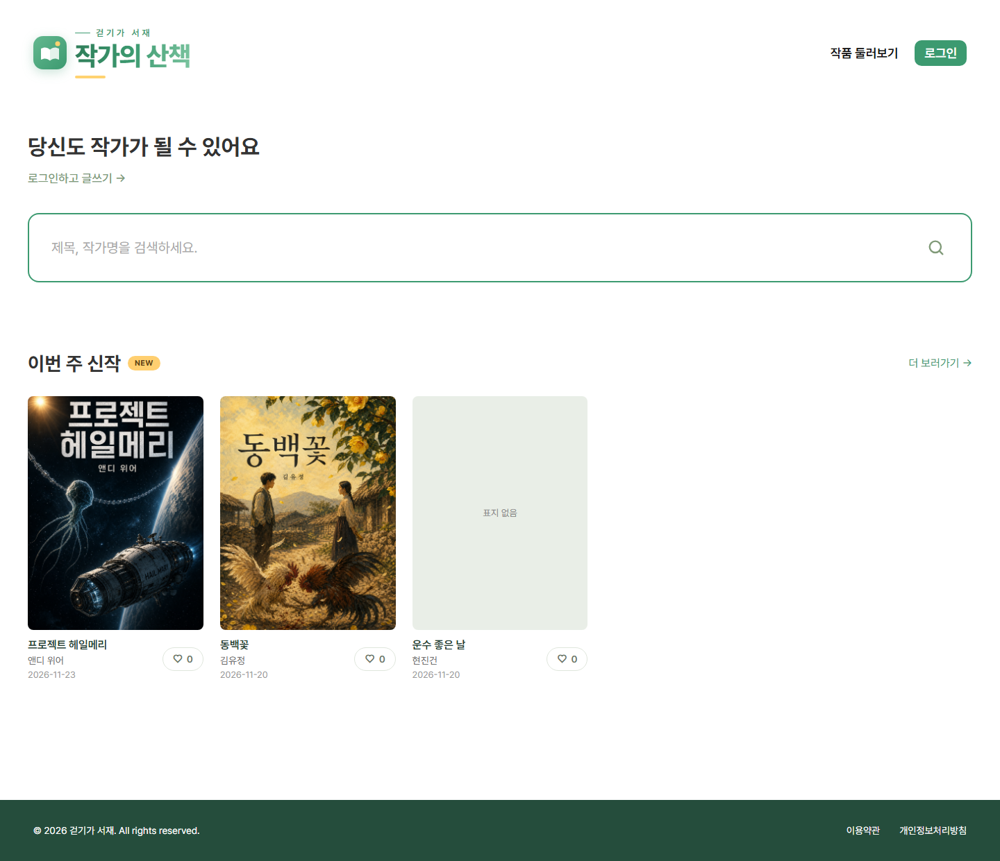
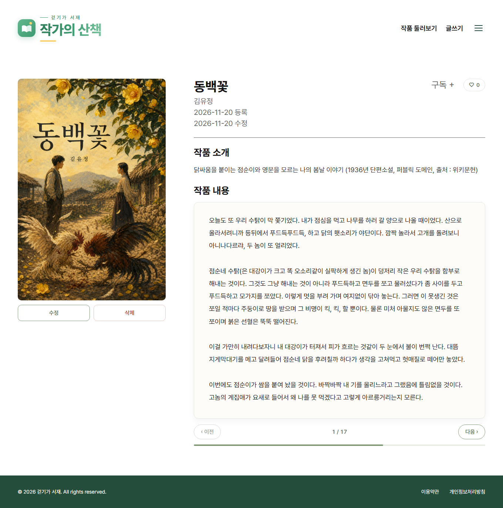
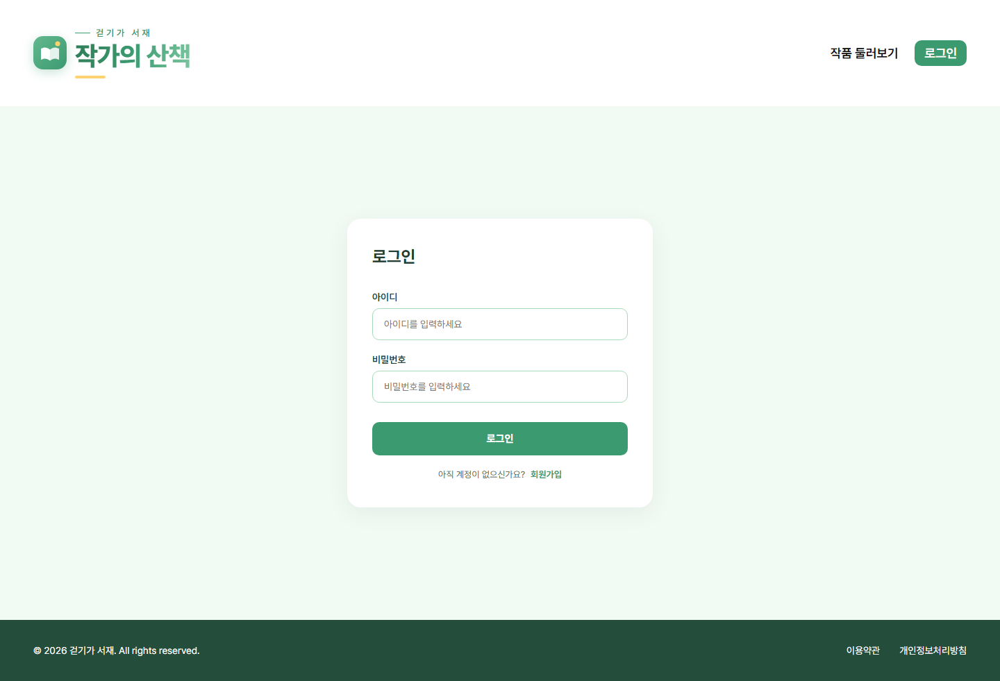
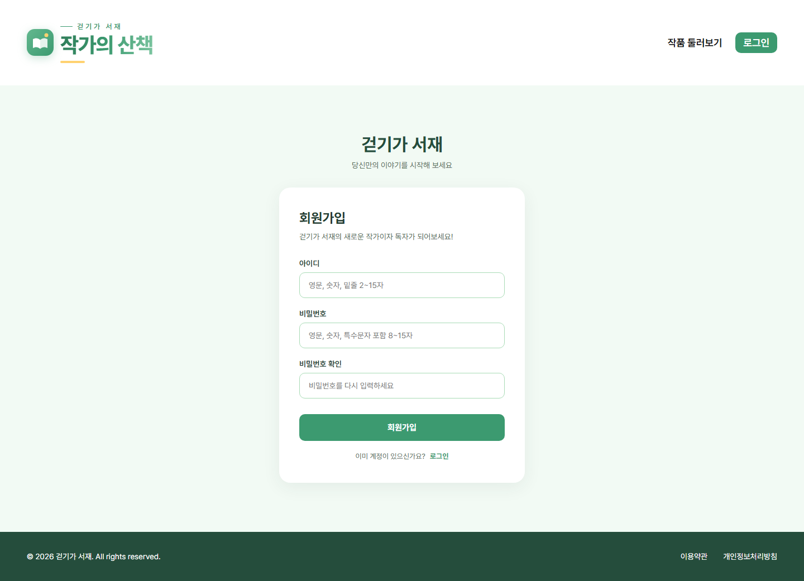
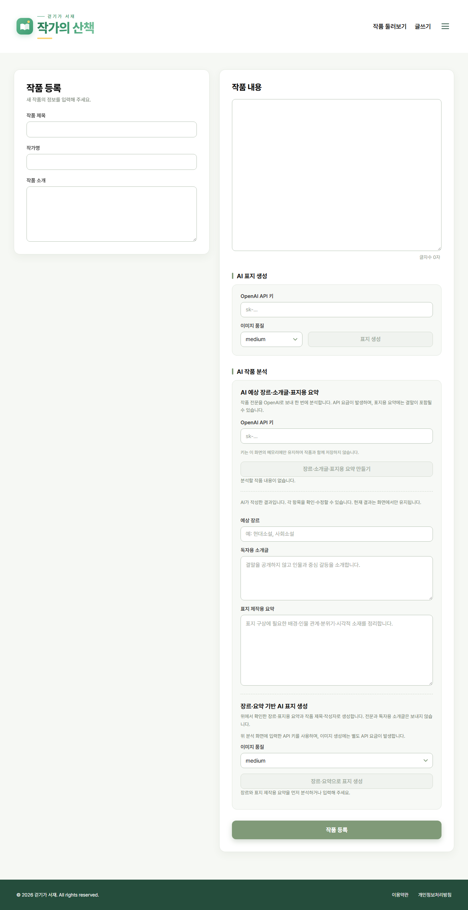
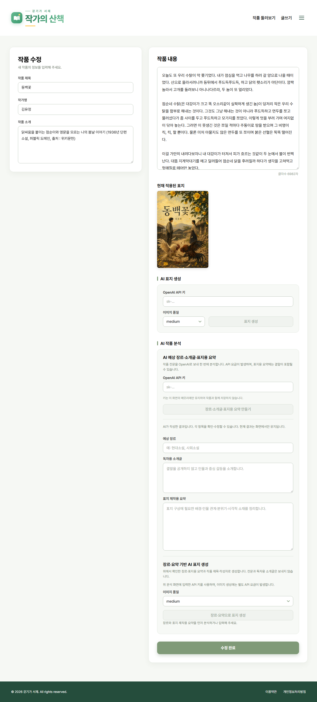

# 작가의 산책 (author-walk)

누구나 글을 쓰고, AI 가 글에 어울리는 표지를 만들어 주는 도서 관리 시스템입니다. <br>
등록과 수정 화면에서 AI로 작품을 분석하고 표지를 만들 수 있습니다.<br>
화면은 React 19와 Vite로 실행하며, 커스텀 json-server가 작품과 계정을 `db.json`에 저장합니다. <br>
또한, 표지 생성에는 OpenAI GPT Image API 를 사용하고, 서버가 표지를 원본과 목록용 썸네일 파일로 저장합니다.

- [사용자 가이드](#사용자-가이드)
- [개발자 가이드](#개발자-가이드)
- [데이터와 API](#데이터와-api)

## 사용자 가이드

### 로컬에서 실행하기

Node.js **24.7 이상**이 필요합니다. 아래의 `/path/to/author-walk`를 클론한 폴더 경로로 바꿉니다.

Windows PowerShell에서는 `.env`가 없을 때 `Copy-Item .env.example .env`로 파일을 만듭니다.<br>
PowerShell에서 `npm.ps1` 실행이 차단되면 명령의 `npm`을 `npm.cmd`로 바꿉니다.

Bash에서 첫 번째 터미널을 열어 의존성을 설치하고 API 서버를 실행합니다.

```bash
cd "/path/to/author-walk"
npm ci
if [ ! -f .env ]; then
  cp .env.example .env
fi
npm run server
```

API 서버를 켜 둔 채 두 번째 터미널을 열어 화면을 실행합니다.

```bash
cd "/path/to/author-walk"
npm run dev
```

| 터미널 | 명령 | 주소 |
| --- | --- | --- |
| 1 | `npm run server` | `http://localhost:3000/books` |
| 2 | `npm run dev` | [http://localhost:5173](http://localhost:5173) |

| 로그인 후 메인과 헤더 메뉴 | 전체 작품 목록 |
| --- | --- |
|  |  |

화면을 열고 **작품 둘러보기**에서 예시 작품을 읽을 수 있습니다.
글을 쓰려면 [로그인과 회원가입](#로그인과-회원가입) 안내를 참고하세요.

### 작품 찾아보기

로컬 예시 데이터로 실행한 화면입니다.

메인(`/main`)에서 최근 7일 안에 등록된 신작을 최대 5개 보여 줍니다.<br>
제목이나 작가명으로 검색할 수 있고, 전체 작품 목록(`/books`)에서는 최신 등록순과 이름순으로 정렬할 수 있습니다.



#### 작품 상세

카드를 선택하면 작품 상세(`/books/:id`)가 열립니다. 소개와 본문을 읽고 좋아요를 누를 수 있습니다.<br>
본문 페이지는 이전 및 다음 버튼, 방향키, 터치 스와이프로 넘깁니다. 작품 소유자와 관리자에게 **수정** 및 **삭제** 버튼이 표시됩니다.

같은 작품 **동백꽃**(`/books/2`)을 두 예시 계정으로 열어 비교했습니다. 작품 소유자인 영희 계정에서는 버튼을 사용할 수 있고, 길동 계정에서는 버튼 영역이 숨겨집니다.

| 영희 (`younghee5678`), 동백꽃 소유자 | 길동 (`gildong1234`), 동백꽃 열람 |
| --- | --- |
|  |  |

### 로그인과 회원가입

회원가입이 끝나면 로그인 화면으로 이동합니다. 로그인에 성공하면 메인으로 돌아갑니다.

| 로그인 (`/login`) | 회원가입 (`/signup`) |
| --- | --- |
|  |  |

회원가입을 하거나 아래 로컬 예시 계정으로 로그인할 수 있습니다. 작품을 등록하려면 로그인하세요.

| 예시 계정 | 역할 | 등록된 작품 |
| --- | --- | --- |
| `gildong1234` | `user` | 운수 좋은 날 |
| `younghee5678` | `user` | 동백꽃 |
| `admin` | `admin` | 없음 (모든 작품을 수정, 삭제할 수 있음) |

로그인 후에도 주소는 `/main`입니다. 헤더에 **글쓰기**와 메뉴가 표시되고, 메뉴에서 로그아웃할 수 있습니다.<br>
마이페이지, 내 작품, 구독 작품을 선택하면 준비 중 화면이 열립니다.

### 작품 등록과 수정

아이디와 비밀번호는 로그인 화면에서 입력합니다. 로그인 후 헤더의 **글쓰기**에서 제목, 작가명, 작품 소개, 본문을 입력합니다.

상세 화면의 **수정**을 누르면 기존 작품 정보가 표시됩니다. 서버는 로그인한 계정으로 등록 작품의 소유자를 정하고, 수정할 때는 작품 소유자 또는 관리자 권한을 확인합니다.

| 길동 계정으로 작품 등록 (`/books/new`) | 영희 계정으로 동백꽃 수정 (`/books/2/edit`) |
| --- | --- |
|  |  |

### AI 작품 분석과 표지 생성

등록 또는 수정 화면에서 OpenAI API 키를 입력하면 작품 분석과 표지 생성 기능을 사용할 수 있습니다.

1. **AI 표지 생성**에서 제목, 작가명, 본문을 바탕으로 표지를 만들 수 있습니다.
2. **AI 작품 분석**은 작품 전문에서 예상 장르, 독자용 소개글, 표지용 요약을 만듭니다. <br>
화면에서 결과를 고친 뒤 장르와 요약을 바탕으로 표지를 생성할 수 있습니다. 독자용 소개글을 작품에 쓰려면 **작품 소개** 칸에 옮겨 적습니다.
3. 미리보기에서 표지를 선택하고 **작품 등록** 또는 **수정 완료**를 누르면 작품과 함께 저장됩니다. <br>
서버가 표지를 원본 (png) 과 목록용 썸네일 (webp) 파일로 저장하고, 목록에는 썸네일, 상세와 수정 화면에는 원본을 보여 줍니다.

AI 요청은 브라우저에서 OpenAI로 직접 전송되며 사용자 API 키로 요금이 발생합니다. <br>
API 키와 분석 결과는 현재 화면에서만 유지됩니다.

## 개발자 가이드

### 환경 변수와 공유 API

| 이름 | 설정 |
| --- | --- |
| `VITE_API_URL` | 화면이 호출하는 API 주소입니다. 기본값은 `http://localhost:3000`이며, 변경 후 Vite를 다시 실행합니다. |
| `JWT_SECRET` | 서버의 로그인 토큰 서명 키입니다. 비워 두면 서버 시작 시 임시 키를 만들며, 서버를 재시작하면 다시 로그인해야 합니다. 재시작 후에도 발급된 토큰을 사용하려면 아래 명령으로 만든 값을 넣습니다. |

```bash
node -e "console.log(require('node:crypto').randomBytes(32).toString('base64url'))"
```

`.env`는 로컬 설정 파일로 관리합니다. `JWT_SECRET`은 서버에서만 읽도록 이름에 `VITE_` 접두사를 제외했습니다.

팀에서 같은 데이터를 보려면 한 사람이 `npm run server`로 API를 실행하고, 팀원은 각자 `VITE_API_URL`을 공유 API 주소로 설정합니다.<br>
Cloudflare 터널을 사용한다면 같은 컴퓨터에서 `cloudflared tunnel --url http://127.0.0.1:3000`으로 연결할 수 있습니다.<br>
터널 주소에서는 작품 조회와 좋아요 요청이 공개되며, 작품 등록, 수정, 삭제에는 로그인 토큰이 필요합니다.

### 개발 명령

| 명령 | 용도 |
| --- | --- |
| `npm run dev` | Vite 개발 서버 실행 |
| `npm run server` | `db.json`을 사용하는 API 서버 실행 |
| `npm run server:watch` | 서버 코드 변경 시 자동 재시작 |
| `npm run server-with-delay` | 응답을 1초 늦춰 로딩 상태 확인 |
| `npm run build` | 배포용 빌드 생성 |
| `npm run preview` | 빌드 결과를 로컬에서 확인 |
| `npm run lint` | ESLint로 코드 검사 |
| `npm run set-role -- my_user admin` | 가입된 계정을 관리자로 변경. 마지막 인자를 `user`로 바꾸면 일반 사용자로 변경 |
| `npm run extract-covers` | `db.json` 안의 Data URL 표지를 파일로 옮기는 일회성 데이터 마이그레이션 (실행 전 `db.json` 자동 백업, 서버를 끈 상태에서 실행) |

### 코드 구조

```text
src/
  main.jsx                      라우터와 로그인 및 좋아요 Provider 설정
  App.jsx                       화면 경로와 공통 작품 목록 상태
  pages/                        메인, 작품, 로그인 및 회원가입 화면
  components/                   헤더, 푸터, 검색창 등 공용 화면 요소
  api/client.js                 공통 API 요청 및 응답 처리, 표지 주소 변환 (toApiUrl)
  features/
    auth/                       계정 API, 로그인 상태 및 입력 검사
    books/                      작품 API, 훅, 신작 카드, 좋아요, 본문 뷰어, 표지 이미지 (CoverImage)
    OpenAI_Integration/         AI 분석과 표지 생성
  utils/                        입력 검사, 문자열 처리, 공통 권한 판단
  examples/                     API 함수 확인용 예시 화면
server/
  index.js                      커스텀 json-server 진입점
  routes/                       계정 API와 작품 API
  middlewares/                  토큰 확인, 작품 권한 검사, 표지 저장, 지연 응답
  utils/                        비밀번호 해시, 토큰, 계정, 표지 파일 처리
  scripts/                      계정 역할 변경 (setRole.js), 표지 옮기기 (extractCovers.js)
  covers/                       저장된 표지 파일 (git 에 올리지 않음)
db.json                         작품과 계정 데이터
```

#### 코드 배치와 import 규칙

폴더를 나눈 기준과 예시는 [docs/STRUCTURE.md](docs/STRUCTURE.md) 에 정리되어 있습니다.

- 한 기능에서만 쓰는 코드는 `src/features/<기능>/` 아래에 둡니다. 서버 요청은 `api/`, React 상태는 `hooks/`, <br>
화면 요소는 `components/`, 규칙과 계산은 `utils/`, JSDoc 타입은 `types.js`에 둡니다.
- 여러 기능에서 쓰는 코드는 `src/api/`, `src/components/`, `src/utils/` 등 공용 위치에 둡니다. <br>
예를 들어 `src/utils/roles.js`의 `canModifyBook`은 상세 화면의 버튼 표시와 서버 권한 검사에 함께 사용됩니다.
- 같은 기능 내부에서는 상대 경로를 사용합니다. 공용 파일은 `src/`를 가리키는 `#src/` 별칭으로 가져올 수 있습니다. <br>
필요한 파일을 직접 import합니다.
- 여러 기능은 `App.jsx`나 각 페이지에서 조합합니다. `App.jsx`가 로그인 토큰을 `useBookList`에 넘기고, <br>
등록 및 수정 페이지가 AI 컴포넌트에 표지 선택 콜백을 넘기는 방식입니다. <br>
다른 기능의 JSDoc 타입은 주석에서 참조할 수 있습니다.
- `utils/`에는 React 상태, 네트워크 요청, 환경 변수에 의존하지 않는 순수 함수를 둡니다. <br>
예를 들어 입력 검사 함수는 브라우저와 Node 서버에서 함께 사용할 수 있습니다.

```js
import { isBlank } from '#src/utils/validation/text.js';
import { getBooks } from '../api/booksApi.js';
```

함수 이름은 불리언을 반환하면 `is` 또는 `has`, 입력을 검사하고 오류 문구를 반환하면 <br>
`validate`, 계산과 값 정리는 `count` 또는 `normalize`를 붙입니다. <br>
서버 데이터를 다루는 함수는 `get`, `create`, `update`, `delete`로 시작하고, React 훅은 `use`로 시작합니다. <br>
고정값은 `TIMEOUT_MS`처럼 대문자와 밑줄을 씁니다.

새 코드의 작품 API는 `features/books/api/booksApi.js`에서, 작품 훅은 `features/books/hooks/useBooks.js`에서 가져옵니다. <br>
호환 경로인 `features/books/booksApi.js`와 `features/books/useBooks.js`는 현재 구현을 다시 내보냅니다. <br>
이전 훅 이름 `useBooks`와 `useBook`에 대응하는 현재 이름은 `useBookList`와 `useBookDetail`입니다.

#### 화면에서 사용하는 훅

| 훅 | 역할 |
| --- | --- |
| `useBookList(token)` | `App.jsx`에서 전체 목록, 로딩과 오류 상태를 관리합니다. `reload()`로 다시 조회하며, `addBook`, `editBook`, `changeCover`, `removeBook`이 성공하면 목록 상태에 반영합니다. |
| `useBookDetail(id)` | ID로 작품을 조회하고 `book`, `loading`, `error`, `setBook`을 제공합니다. |
| `useBookLikes()` | 메인, 전체 목록, 상세에서 최신 좋아요 수와 요청 상태를 공유합니다. |
| `useAuth()` | 로그인 계정, 토큰, 확인 중 상태와 로그인 및 로그아웃 함수를 제공합니다. |

### 화면과 서버의 동작

1. **회원가입과 로그인.** 가입할 때 서버가 비밀번호를 Argon2id로 해시해 `users`에 저장하고 일반 사용자 역할을 부여합니다.<br>
로그인하면 1시간 유효한 JWT를 발급합니다. 화면은 토큰을 브라우저에 저장하고 `GET /auth/me`에서 로그인 아이디와 역할을 조회합니다. 유효한 토큰이 있으면 새로고침 후에도 로그인 상태를 복원합니다.
2. **작품 조회와 검색.** `App.jsx`에서 `useBookList(token)`을 한 번 호출해 메인과 전체 목록에 데이터를 전달합니다. <br>
두 화면은 각자의 검색어로 제목과 작가명을 브라우저에서 필터링합니다. <br>
상세 화면과 수정 화면은 `useBookDetail(id)`로 작품 한 편을 조회합니다.
3. **작품 등록, 수정, 삭제.** 세 작업에는 로그인 토큰을 보냅니다. <br>
서버가 로그인 계정을 등록 작품의 소유자로 저장하고, 수정과 삭제는 해당 작품의 소유자 또는 관리자에게 허용합니다. <br>
수정 화면은 바뀐 항목만 보냅니다. 저장에 성공하면 상세로 이동하고, 삭제에 성공하면 메인으로 돌아갑니다.
4. **좋아요.** 메인, 전체 목록, 상세에서 하트를 누르면 서버가 작품의 좋아요 수를 1 올립니다. <br>
화면은 서버가 반환한 수를 공유 상태에 반영합니다. 작품 조회와 좋아요는 로그인 없이 사용할 수 있습니다.
5. **표지 저장과 표시.** 화면은 선택한 표지를 PNG Data URL 로 보내고, 서버가 형식과 크기를 검사한 뒤 `server/covers/<무작위 이름>/` 에 <br>
`original.png` 와 `thumbnail.webp` (가로 320px) 로 저장해 `db.json` 에는 두 주소만 남깁니다. 표지를 바꾸거나 작품을 삭제하면 이전 파일도 지웁니다. <br>
화면은 `toApiUrl` 로 API 서버 주소를 붙여 이미지를 불러오고, 파일을 불러오지 못하면 `CoverImage` 가 썸네일, 원본, "표지 없음" 순서로 대체합니다.

### AI 컴포넌트 구성과 연결

세 컴포넌트는 `src/features/OpenAI_Integration/components/`에 있습니다. <br>
`hooks/`는 입력 상태와 요청 진행 상태를 관리하고, `api/`는 요청을 보내고 응답 형식을 검사합니다.

| 컴포넌트 | 입력과 처리 | 결과 |
| --- | --- | --- |
| `BookCoverGenerator.jsx` | 제목, 작가명, 작품 전문을 받아 `gpt-image-2`로 표지 생성 | 품질을 선택하고 이미지를 미리 볼 수 있습니다. 표지를 선택하면 `onSave(dataUrl)`을 호출합니다. |
| `BookAnalysis.jsx` | 제목과 작품 전문을 `gpt-4.1-mini`로 분석 | 예상 장르, 독자용 소개글, 표지용 요약을 편집하고 JSON으로 확인할 수 있습니다. 확인할 사항이 있으면 별도로 표시합니다. |
| `SummaryBookCoverGenerator.jsx` | 제목, 작가명, 장르, 표지용 요약으로 `gpt-image-2`에 요청 | 분석 영역에서 입력한 키를 사용합니다. `BookAnalysis`에 `onSaveCover`를 넘기면 표지 저장 버튼이 표시됩니다. |

두 표지 생성 방식 모두 세로형 1024×1536 PNG를 요청합니다. <br>
이미지 품질은 `low`, `medium`, `high`, `auto` 중에서 선택할 수 있고 기본값은 `medium`입니다. <br>
분석 응답의 필드와 JavaScript 문자열 길이는 다음 기준으로 검증합니다.

| 분석 필드 | 내용 | 최대 길이 |
| --- | --- | --- |
| `genre` | 예상 장르 | 100자 |
| `introduction` | 결말과 반전을 드러내지 않도록 작성한 독자용 소개글 | 500자 |
| `summary` | 배경, 인물 관계, 분위기와 시각적 소재를 담은 표지 제작용 요약. 필요한 경우 결말의 소재도 포함 | 2,000자 |
| `warnings` | 분석할 때 확인할 사항 | 최대 5개, 각각 300자 |

등록과 수정 화면은 `book`에 제목, 작가명, 본문이 담긴 폼 데이터를 넘깁니다. <br>
두 생성 방식에는 선택한 이미지를 폼 상태로 받는 같은 콜백을 연결합니다.

```jsx
const handleSaveCover = async (dataUrl) => {
  setCoverImageUrl(dataUrl);
};

return (
  <>
    <BookCoverGenerator book={aiBook} onSave={handleSaveCover} />
    <BookAnalysis book={aiBook} onSaveCover={handleSaveCover} />
  </>
);
```

컴포넌트가 화면에서 제거되면 진행 중인 브라우저 요청을 취소합니다. <br>
장르나 요약을 수정하면 요약 기반 표지의 미리보기가 초기화됩니다. <br>
`SummaryBookCoverGenerator`를 별도 화면에서 사용할 때는 `title`, `author`, `genre`, `summary`, `userApiKey`를 전달하고 <br>
표지 선택이 필요하면 `onSave`를 연결합니다.

작품을 저장할 때 화면은 선택한 표지를 PNG Data URL로 보냅니다. 서버는 원본 PNG와 목록용 WebP 썸네일을 파일로 저장하고 작품 데이터에 두 이미지 주소를 기록합니다.

## 데이터와 API

### `db.json`에 저장되는 값

| 컬렉션 | 필드 | 설명 |
| --- | --- | --- |
| `books` | `id`, `title`, `author`, `description`, `content` | 작품 번호와 화면에 표시하는 정보. `author`는 수정 가능한 작가명입니다. |
| `books` | `userId` | 소유자 계정의 로그인 아이디 |
| `books` | `coverImageUrl`, `coverThumbnailUrl`, `likes` | 표지 원본 주소, 썸네일 주소, 누적 좋아요 수. 새 작품의 좋아요는 0에서 시작합니다. |
| `books` | `createdAt`, `updatedAt` | 등록 및 수정 시각 |
| `users` | `id`, `userId`, `passwordHash`, `role`, `createdAt` | 계정 번호, 로그인 아이디, 비밀번호 해시, 역할, 가입 시각 |

작품의 `userId`는 `users.userId`에 저장된 로그인 아이디와 연결됩니다. `users.id`는 계정 레코드의 번호입니다. <br>
서버는 계정에 비밀번호 해시를 저장하고 `/users`와 `/db`에 대한 직접 접근을 차단합니다.

가입한 계정의 기본 역할은 `user`이며 자기 작품을 수정하거나 삭제할 수 있습니다. `admin`은 모든 작품을 수정하거나 삭제할 수 있습니다. <br>
서버는 요청할 때마다 역할을 조회하므로, `set-role`로 바꾼 역할은 DB가 다시 로드된 후 다음 요청에 반영됩니다. <br>
화면의 버튼 표시는 현재 계정 정보를 다시 조회할 때 갱신됩니다. 같은 작품을 동시에 수정하면 같은 항목에는 마지막 저장 값이 남습니다.

### 전체 엔드포인트

#### 프로젝트 API 서버

기본 주소는 `http://localhost:3000`입니다. 인증이 필요한 요청은 `Authorization: Bearer <token>` 헤더를 사용합니다. `HEAD` 응답은 상태 코드와 헤더만 보냅니다.

| HTTP 요청 | 접근 권한 | 동작과 성공 응답 |
| --- | --- | --- |
| `POST /auth/signup` | 공개 | `signup(userId, password)`로 계정을 등록합니다. `201`과 가입 완료 메시지를 반환합니다. |
| `POST /auth/login` | 공개 | `login(userId, password)`로 로그인합니다. `200`과 `{ token }`을 반환합니다. |
| `GET /auth/me` | 로그인 계정 | `200`과 `{ user: { userId, role } }`을 반환합니다. `getMe(token)`은 응답의 `user`를 꺼내 반환합니다. |
| `HEAD /auth/me` | 로그인 계정 | 동일한 토큰 검사를 거쳐 `200`과 응답 헤더를 반환합니다. |
| `GET /books` | 공개 | `200`과 작품 배열을 반환합니다. `getBooks(query?)`는 받은 배열에 검색과 정렬 조건을 적용합니다. |
| `HEAD /books` | 공개 | 작품 목록 요청의 `200` 상태와 응답 헤더를 반환합니다. |
| `POST /books` | 로그인 계정 | `createBook(input, token)`으로 작품을 등록합니다. `201`과 번호가 붙은 작품을 반환합니다. |
| `GET /books/:id` | 공개 | `getBook(id)`로 작품 한 편을 조회합니다. `200`과 해당 작품을 반환합니다. |
| `HEAD /books/:id` | 공개 | 작품 상세 요청의 `200` 상태와 응답 헤더를 반환합니다. |
| `PATCH /books/:id` | 작품 소유자 또는 관리자 | 바뀐 항목을 저장하고 `200`과 수정된 작품을 반환합니다. `updateBook(id, changes, token)`과 `saveCover(id, dataUrl, token)`이 이 요청을 사용합니다. |
| `PUT /books/:id` | 작품 소유자 또는 관리자 | 작품 전체를 교체하고 `200`과 저장된 작품을 반환합니다. 소유자, 좋아요 수, 요청에 표지가 빠진 경우 기존 표지 주소를 유지합니다. |
| `DELETE /books/:id` | 작품 소유자 또는 관리자 | `deleteBook(id, token)`으로 작품을 삭제합니다. `200`과 빈 객체를 반환합니다. |
| `POST /books/:id/likes` | 공개 | `incrementBookLikes(id)`로 좋아요를 1 올립니다. `200`과 `{ likes }`를 반환합니다. |
| `GET /covers/:uuid/original.png` | 공개 | 상세와 수정 화면에서 사용하는 원본 PNG를 반환합니다. |
| `HEAD /covers/:uuid/original.png` | 공개 | 원본 PNG의 응답 헤더를 반환합니다. |
| `GET /covers/:uuid/thumbnail.webp` | 공개 | 작품 카드에서 사용하는 WebP 썸네일을 반환합니다. |
| `HEAD /covers/:uuid/thumbnail.webp` | 공개 | WebP 썸네일의 응답 헤더를 반환합니다. |
| `GET /favicon.svg` | 공개 | `public/`에 있는 사이트 아이콘을 반환합니다. |
| `HEAD /favicon.svg` | 공개 | 사이트 아이콘의 응답 헤더를 반환합니다. |
| `GET /icons.svg` | 공개 | `public/`에 있는 SVG 아이콘 파일을 반환합니다. |
| `HEAD /icons.svg` | 공개 | SVG 아이콘 파일의 응답 헤더를 반환합니다. |
| `OPTIONS <요청 경로>` | 공개 | 브라우저의 CORS 사전 요청에 `204`와 CORS 헤더를 반환합니다. |

엔드포인트별 요청과 응답 예시는 [docs/API.md](docs/API.md)에 있습니다.

#### OpenAI 요청

등록 및 수정 화면은 사용자가 입력한 키로 `https://api.openai.com`에 직접 요청합니다.

| HTTP 요청 | 동작과 응답 |
| --- | --- |
| `POST /v1/responses` | `gpt-4.1-mini`로 작품을 분석합니다. 화면에서 예상 장르, 독자용 소개글, 표지용 요약과 확인할 사항을 읽습니다. |
| `POST /v1/images/generations` | `gpt-image-2`로 표지를 만듭니다. 본문 기반 생성과 장르 및 요약 기반 생성이 모두 이 요청을 쓰며, 응답의 `b64_json`을 PNG Data URL로 변환합니다. |

#### 작품 요청 본문 예시

등록 본문에는 작품 정보와 시각을 담고, 작품 번호와 소유자, 초기 좋아요 수는 서버가 채웁니다.

```json
{
  "title": "새벽 네 시의 등대지기",
  "author": "홍길동",
  "description": "외딴섬 등대지기의 하루",
  "content": "안개가 짙은 작은 섬에 등대를 지키는 노인이 있다.",
  "coverImageUrl": null,
  "createdAt": "2026-11-20T14:00:00.000Z",
  "updatedAt": "2026-11-20T14:00:00.000Z"
}
```

수정 화면은 바뀐 항목과 수정 시각만 보냅니다. <br>
제목만 바꾸면 요청 본문은 `{ "title": "새 제목", "updatedAt": "2026-11-20T15:00:00.000Z" }`처럼 구성됩니다. <br>

삭제 요청에는 토큰 헤더를 넣습니다.<br>
예를 들어, 1번 작품을 삭제하려면 `DELETE /books/1` 요청에 `Authorization: Bearer <로그인 토큰>` 헤더를 넣습니다.

### 오류 처리

| 상황 | 응답과 화면 처리 |
| --- | --- |
| 가입 입력이 규칙에 맞지 않거나 아이디가 중복됨 | `400` 또는 `409`와 `errors` 객체. 화면이 해당 입력란에 메시지를 표시합니다. |
| 로그인 실패 또는 토큰이 유효하지 않음 | `401`. 작품 API는 로그인 안내를 `error.cause === 'NOT_OWNER'`로 전달합니다. |
| 작품을 수정하거나 삭제할 권한이 없음 | `403`. 작품 API는 권한 오류 문구를 같은 `NOT_OWNER` 값으로 전달합니다. |
| 작품이 없음 | `404`. 작품 API 오류의 `cause`는 숫자 `404`입니다. |
| 표지 값이 이미지 Data URL, `null`, 지금 저장된 주소가 아님 | `400`과 `message`. |
| 공통 API 응답 30초 초과 또는 네트워크 연결 실패 | 브라우저에서 각각 `TimeoutError` 또는 `TypeError`가 발생합니다. |

### 알아 둘 점

- 표지 파일은 API 서버를 켠 컴퓨터의 `server/covers/` 에만 있습니다. 서버 컴퓨터를 바꿀 때는 `db.json` 과 이 폴더를 함께 옮깁니다.
- API 서버는 파일 (`db.json`, `server/covers/`) 에 저장하므로, 서버리스가 아닌 계속 켜져 있는 서버 한 대에서 실행합니다.
- 좋아요는 누를 때마다 1씩 늘어나며, 사용자별 한 번 제한과 취소는 아직 없습니다.
