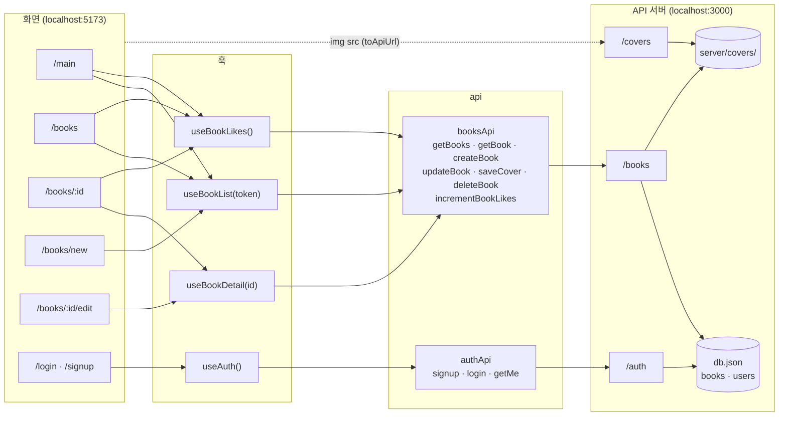
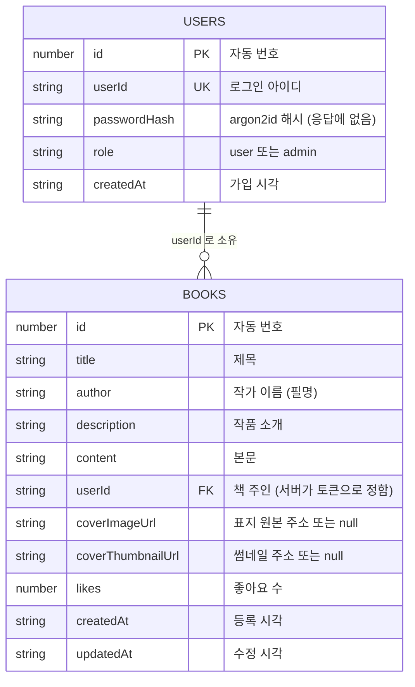

# API 문서 : 작가의 산책

화면 주소마다 어떤 훅과 함수를 쓰고, 그 함수가 서버에 어떤 요청을 보내며 무엇을 돌려받는지 정리한 문서입니다.   
아래 응답 예시는 실제 서버에 요청을 보내 받은 값입니다 (토큰은 `<JWT>`, 표지 폴더 이름은 `<uuid>` 로 가림).

| 코드 위치 | 내용 |
| --- | --- |
| `src/api/client.js` | 공통 요청 `request`, 표지 주소 `toApiUrl` |
| `src/features/auth/` | `authApi.js` (signup, login, getMe), `useAuth` |
| `src/features/books/` | `booksApi.js`, `useBooks.js` (useBookList, useBookDetail, useBookLikes), `types.js` |
| `server/` | API 서버 (`routes/auth.js`, `routes/books.js`, `index.js` 의 `/covers`) |

---

## 1. 관계도

### 전체 흐름



### 데이터 관계



- 표지 파일은 `server/covers/<uuid>/original.png`, `thumbnail.webp` 로 저장되고, `books` 에는 주소만 남습니다

---

## 2. 화면 주소

| 화면 주소 | 화면 | 로그인 | 쓰는 훅, 함수 |
| --- | --- | --- | --- |
| `/` | `/main` 으로 이동 | | |
| `/main` | 메인 (인사말, 검색, 이번 주 신작) | 필요 없음 (로그인하면 인사말) | `useAuth`, `useBookList`, `useBookLikes` |
| `/books` | 전체 작품 (검색, 정렬) | 필요 없음 | `useBookList`, `useBookLikes` |
| `/books/:id` | 작품 상세 (본문 넘김 뷰어, 좋아요, 수정, 삭제) | 수정, 삭제 버튼은 주인 또는 admin 에게만 보임 | `useBookDetail`, `useAuth`, `removeBook` |
| `/books/new` | 작품 등록 (AI 표지 생성, 작품 분석) | 필요 (헤더의 글쓰기는 로그인했을 때만 보임) | `addBook` |
| `/books/:id/edit` | 작품 수정 (AI 표지 재생성) | 저장은 주인 또는 admin 만 (서버가 확인) | `useBookDetail`, `editBook` |
| `/login` | 로그인 | | `useAuth().login` |
| `/signup` | 회원가입 | | `signup` |
| 그 밖의 주소 | 준비 중인 페이지 (마이페이지, 내 작품, 구독 작품 포함) | | |

---

## 3. 화면별 서버 요청

| 화면 | 서버 요청 (http://localhost:3000 생략) |
| --- | --- |
| 메인, 전체 작품 | `GET /books` (검색, 정렬, 기간은 받은 목록에서 화면이 처리) |
| 작품 상세 | `GET /books/:id` |
| 작품 등록 | `POST /books` |
| 작품 수정 | `GET /books/:id` (기존 값), `PATCH /books/:id` (바뀐 필드만) |
| 작품 삭제 | `DELETE /books/:id` |
| 좋아요 | `POST /books/:id/likes` |
| 표지 이미지 | `GET /covers/<uuid>/thumbnail.webp` (목록), `GET /covers/<uuid>/original.png` (상세, 수정) |
| 로그인 | `POST /auth/login`, 이어서 `GET /auth/me` |
| 새로고침 | 저장된 토큰이 있으면 `GET /auth/me` |
| 회원가입 | `POST /auth/signup` |

---

## 4. 엔드포인트

- 기본 주소 : `.env` 의 `VITE_API_URL` (없으면 `http://localhost:3000`)
- 모든 요청은 30초 안에 응답이 없으면 `TimeoutError` 로 실패합니다
- 로그인이 필요한 요청은 `Authorization: Bearer <JWT>` 헤더를 보냅니다 (토큰 유효 시간 1시간)
- 실패 응답 본문은 `{ "message": "..." }` (한 줄 안내) 또는 `{ "errors": { "필드": "..." } }` (칸별 안내) 입니다

### 공통 스키마 : Book

| 필드 | 타입 | 설명 |
| --- | --- | --- |
| `id` | number | 자동 번호 |
| `title` | string | 제목 |
| `author` | string | 작가 이름 (필명) |
| `description` | string | 작품 소개 (없으면 빈 문자열) |
| `content` | string | 본문 |
| `userId` | string | 책 주인 아이디 |
| `coverImageUrl` | string \| null | 표지 원본 주소 (`/covers/<uuid>/original.png`) |
| `coverThumbnailUrl` | string \| null | 썸네일 주소 (`/covers/<uuid>/thumbnail.webp`). 표지가 없던 예전 책에는 필드가 없을 수 있음 |
| `likes` | number | 좋아요 수 |
| `createdAt`, `updatedAt` | string | ISO 시각 |

---

### POST /auth/signup : 회원가입

요청

```json
{ "userId": "docs_writer", "password": "<비밀번호>" }
```

- `userId` : 영문, 숫자, 밑줄 2~15자
- `password` : 8~15자, 영문, 숫자, 특수문자만 (영문, 숫자 각각 하나 이상)
- 역할 (`role`) 은 항상 `user` 로 저장됩니다 (요청에 넣어도 무시)

| 상태 | 응답 |
| --- | --- |
| `201` | `{ "message": "docs_writer 성공적으로 생성되었습니다." }` |
| `400` | 칸별 안내 (아래) |
| `409` | `{ "errors": { "userId": "이미 사용 중인 아이디입니다." } }` |

```json
{
  "errors": {
    "userId": "아이디는 2~15자 사이로 입력해 주세요.",
    "password": "비밀번호는 8~15자 사이로 입력해 주세요."
  }
}
```

### POST /auth/login : 로그인

요청

```json
{ "userId": "docs_writer", "password": "<비밀번호>" }
```

| 상태 | 응답 |
| --- | --- |
| `200` | `{ "token": "<JWT>" }` |
| `401` | `{ "message": "아이디 또는 비밀번호가 맞지 않습니다." }` (아이디가 없을 때도 같은 안내) |

### GET /auth/me : 토큰의 주인

헤더 `Authorization: Bearer <JWT>`

| 상태 | 응답 |
| --- | --- |
| `200` | `{ "user": { "userId": "docs_writer", "role": "user" } }` |
| `401` | `{ "message": "로그인이 필요합니다." }` (토큰 없음, 만료, 잘못된 토큰, 지워진 계정) |

---

### GET /books : 목록

로그인 필요 없음. 응답 `200` : Book 배열 (`passwordHash` 같은 내부 필드는 빠짐)

```json
[
  {
    "id": 1,
    "title": "운수 좋은 날",
    "author": "현진건",
    "description": "비 오는 겨울날, 인력거꾼 김 첨지에게 찾아온 운수 좋은 하루 ...",
    "content": "새침하게 흐린 품이 눈이 올 듯하더니 ...",
    "userId": "gildong1234",
    "coverImageUrl": null,
    "likes": 0,
    "createdAt": "2026-11-20T09:00:00.000Z",
    "updatedAt": "2026-11-20T09:00:00.000Z"
  }
]
```

- 화면 (`getBooks(query)`) 은 전체를 받아 검색어 (`q`), 검색 대상 (`field` : `titleAuthor`, `title`, `author`, `titleContent`), 정렬 (`sort` : `latest`, `oldest`, `title`), 기간 (`days`), 개수 (`limit`) 를 직접 적용합니다

### GET /books/:id : 한 권

| 상태 | 응답 |
| --- | --- |
| `200` | Book |
| `404` | `{}` (화면은 `e.cause === 404`, "도서를 찾을 수 없어요") |

### POST /books : 등록

헤더 `Authorization: Bearer <JWT>`. 요청 (booksApi 가 만들어 보냄)

```json
{
  "title": "새벽의 등대",
  "author": "홍길동",
  "description": "외딴섬 등대지기의 하루",
  "content": "안개가 짙은 작은 섬에...",
  "coverImageUrl": "data:image/png;base64,...",
  "createdAt": "2026-11-24T05:00:00.000Z",
  "updatedAt": "2026-11-24T05:00:00.000Z"
}
```

- `coverImageUrl` : 표지가 없으면 `null`, 있으면 AI 가 만든 이미지 data URL (png, jpeg, webp, 7MB 안쪽)
- 서버가 정하는 값 : `id`, `userId` (토큰의 주인), `likes` (0), `coverThumbnailUrl`. 보낸 값은 무시

| 상태 | 응답 |
| --- | --- |
| `201` | 저장된 Book (아래) |
| `400` | `{ "message": "표지는 새로 만든 이미지만 저장할 수 있습니다." }` 등 표지 값이 잘못됨 |
| `401` | `{ "message": "로그인이 필요합니다." }` |

```json
{
  "title": "새벽의 등대",
  "author": "홍길동",
  "description": "외딴섬 등대지기의 하루",
  "content": "안개가 짙은 작은 섬에...",
  "coverImageUrl": "/covers/<uuid>/original.png",
  "createdAt": "2026-11-24T05:00:00.000Z",
  "updatedAt": "2026-11-24T05:00:00.000Z",
  "userId": "docs_writer",
  "likes": 0,
  "coverThumbnailUrl": "/covers/<uuid>/thumbnail.webp",
  "id": 3
}
```

### PATCH /books/:id : 수정

헤더 `Authorization: Bearer <JWT>`. **바뀐 필드만** 보냅니다.

```json
{ "title": "새벽의 등대 (개정)", "updatedAt": "2026-11-24T06:00:00.000Z" }
```

`coverImageUrl` 을 보낼 때

| 보낸 값 | 처리 |
| --- | --- |
| 이미지 data URL | 새 파일로 저장하고 두 주소로 바꿈, 이전 표지 파일은 삭제 |
| `null` | 표지 없음 (두 주소 모두 `null`), 이전 표지 파일 삭제 |
| 지금 저장된 주소 그대로 | 유지 |
| 그 밖의 값 | `400` |

| 상태 | 응답 |
| --- | --- |
| `200` | 수정된 Book 전체 |
| `400` | 표지 값이 잘못됨 (`{ "message": "..." }`) |
| `401` | `{ "message": "로그인이 필요합니다." }` |
| `403` | `{ "message": "권한이 없습니다." }` (주인도 admin 도 아님) |
| `404` | `{}` |

- `userId`, `likes`, `coverThumbnailUrl` 은 보내도 무시됩니다
- `PUT /books/:id` (전체 교체) 도 같은 규칙이며, `userId`, `likes`, 보내지 않은 표지는 그대로 유지됩니다

### DELETE /books/:id : 삭제

헤더 `Authorization: Bearer <JWT>`. 본문 없음. 표지 파일도 함께 지웁니다.

| 상태 | 응답 |
| --- | --- |
| `200` | `{}` |
| `401` | `{ "message": "로그인이 필요합니다." }` |
| `403` | `{ "message": "권한이 없습니다." }` |
| `404` | `{}` |

### POST /books/:id/likes : 좋아요 +1

로그인 필요 없음. 본문 없음.

| 상태 | 응답 |
| --- | --- |
| `200` | `{ "likes": 1 }` (올라간 뒤의 좋아요 수) |
| `404` | `Not Found` (텍스트) |

---

### GET /covers/:uuid/original.png, GET /covers/:uuid/thumbnail.webp : 표지 이미지

로그인 필요 없음. 화면에서는 `toApiUrl(book.coverImageUrl)` 처럼 API 서버 주소를 붙여 `` 에 씁니다.

| 상태 | 응답 |
| --- | --- |
| `200` | 이미지 (`image/png`, `image/webp`). 한 번 받으면 브라우저가 오래 캐시 (표지를 바꾸면 주소가 바뀜) |
| `404` | `Not Found` (없는 표지, 또는 표지 두 파일 모양이 아닌 주소) |

---

### 막혀 있는 경로

`/db`, `/users`, `/books/:id/<그 밖의 하위 경로>` 는 모든 메서드에서 `404` 입니다.

---

## 5. 에러 정리 (화면에서 받는 것)

| 상황 | 화면에서 받는 것 |
| --- | --- |
| 응답이 30초 넘게 없음 | `e.name === 'TimeoutError'` (훅은 "서버 응답이 느려요") |
| 서버가 꺼져 있음 | `TypeError` (`Failed to fetch`) |
| 없는 도서 | `e.cause === 404` (훅은 "도서를 찾을 수 없어요") |
| 로그인 안 함 (책 등록, 수정, 삭제) | `e.cause === 'NOT_OWNER'`, `e.message` 는 "로그인이 필요합니다." |
| 권한 없음 (책 수정, 삭제) | `e.cause === 'NOT_OWNER'`, `e.message` 는 "이 작품을 수정, 삭제할 권한이 없습니다." |
| 회원가입 입력 오류, 중복 아이디 | `e.cause.errors` 에 칸별 안내 (`{ userId, password }`), 폼이 칸 아래에 표시 |
| 로그인 실패 | `e.message` 는 "아이디 또는 비밀번호가 맞지 않습니다." |
| 그 밖의 실패 응답 | `e.message` 는 서버의 `message` (없으면 "요청 실패 (상태 코드)"), `e.cause.status` 에 상태 코드 |
