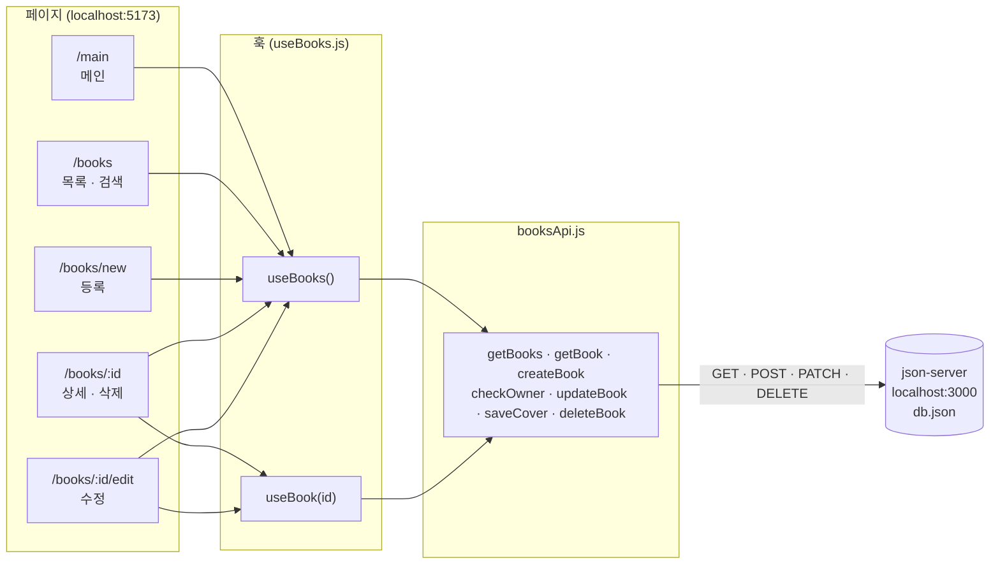
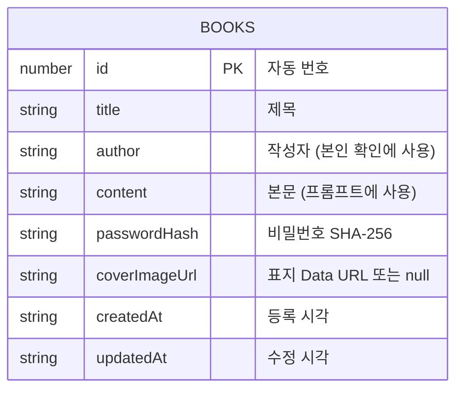

# API 문서 : 작가의 산책

페이지마다 어떤 훅과 함수를 쓰고, 그 함수가 서버에 어떤 요청을 보내는지 정리한 문서입니다.   
코드 위치 : `src/features/books/` (`booksApi.js`, `useBooks.js`, `types.js`)

---

## 1. 관계도

### 전체 흐름




### 데이터 관계



지금은 `books` 하나뿐입니다. 
(향후 `user`를 붙이면 추가될 가능성이 높습니다)
---

## 2. 페이지별 API

| No | 페이지 <br/> http://localhost:5731 생략 | 서버 요청 <br/> http://localhost:3000 생략 |
| --- | --- | --- |
| 1 | 메인 `/main` | `GET /books?_sort=createdAt&_order=desc` |
| 2 | 도서 목록 `/books` | `GET /books?_sort=createdAt&_order=desc` |
| 3 | 도서 상세 `/books/:id` | `GET /books/:id` |
| 4 | 도서 등록 `/books/new` | `POST /books` |
| 5 | 도서 수정 `/books/:id/edit` | `GET /books/:id` (기존 값, 본인 확인)<br>`PATCH /books/:id` |
| 6 | 도서 삭제 `/books/:id` | `GET /books/:id` (본인 확인)<br>`DELETE /books/:id` |
| 8 | 도서 검색 `/books` | `GET /books?...&q=검색어` |
| 9 | 비밀번호 확인 `/books/:id`, `/books/:id/edit` | `GET /books/:id` 후 브라우저에서 해시 비교 |
| 10 | 유효성 검사 `/books/new`, `/books/:id/edit` | 없음. 통과하면 4번 또는 5번 요청 |

---

## 3. json-server 엔드포인트

기본 주소 : `.env` 의 `VITE_API_URL` (없으면 `http://localhost:3000`). 모든 요청은 5초 안에 응답이 없으면 `TimeoutError` 로 실패합니다.

### GET /books : 목록, 검색

| 쿼리 | 뜻 |
| --- | --- |
| `_sort=createdAt&_order=desc` | 등록일 최신순 |
| `q=검색어` | 모든 필드에서 검색 (제목만 찾으려면 `title_like=검색어`) |

응답 `200` : 도서 배열. booksApi 는 `passwordHash` 를 빼고 돌려줍니다.

```json
[
  {
    "id": 2,
    "title": "봄날의 기록",
    "author": "김영희",
    "content": "봄날의 일상과 소중한 추억을 기록한 이야기입니다.",
    "coverImageUrl": null,
    "createdAt": "2026-11-20T10:00:00.000Z",
    "updatedAt": "2026-11-20T10:00:00.000Z"
  }
]
```

### GET /books/:id : 한 권

응답 `200` : 도서 하나. 없는 id 면 `404` (booksApi 는 `e.cause === 404` 인 에러를 던짐).

### POST /books : 등록

요청 본문 (booksApi 가 만들어 보냄)

```json
{
  "title": "새벽 4시의 등대지기",
  "author": "홍길동",
  "content": "안개가 짙은 작은 섬에 등대를 지키는 노인이 있다...",
  "passwordHash": "03ac6742...",
  "coverImageUrl": null,
  "createdAt": "2026-11-20T14:00:00.000Z",
  "updatedAt": "2026-11-20T14:00:00.000Z"
}
```

- 화면에서는 평문 `password` 를 넘기고, booksApi 가 해시로 바꿔 `passwordHash` 로 보냅니다
- `id` 는 보내지 않습니다. json-server 가 붙입니다

응답 `201` : `id` 가 붙은 저장본.

### PATCH /books/:id : 수정

**바뀐 필드만** 보냅니다.

```json
{ "title": "새 제목", "updatedAt": "2026-11-20T15:00:00.000Z" }
```


응답 `200` : 수정된 도서 전체.

### DELETE /books/:id : 삭제

본문 없음. 응답 `200` : 빈 객체 `{}`.

---

## 4. 에러 정리

| 상황 | 화면에서 받는 것 |
| --- | --- |
| 응답이 5초 넘게 없음 | `e.name === 'TimeoutError'` (훅은 "서버 응답이 느려요") |
| 없는 도서 | `e.cause === 404` (훅은 "도서를 찾을 수 없어요") |
| 작성자 · 비밀번호 불일치 | `e.cause === 'NOT_OWNER'`, `e.message` 를 그대로 보여 줘도 됨 |
| json-server 가 꺼져 있음 | `TypeError` (`Failed to fetch`) |
