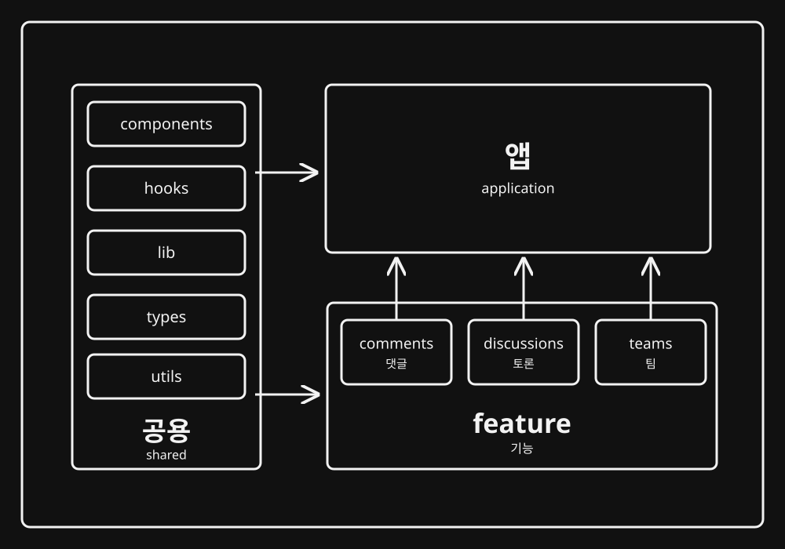

# 🗄️ 프로젝트 구조 (Bulletproof React 일부 번역본)

> **안내**   
> [Bulletproof React 의 Project Structure](https://github.com/alan2207/bulletproof-react/blob/master/docs/project-structure.md) 문서의 일부를 한국어로 옮긴 것입니다.   
> `ts` 확장자는 TypeScript로, JavaScript에서 타입 강제를 추가한 언어로 보시면 됩니다.    
(`tsx`는 `jsx`처럼 여기에 <태그>를 작성할 수 있도록 확장한 버전 입니다.)


---

대부분의 코드는 `src` 폴더 안에 있으며, 대략 다음과 같은 모습입니다.

```sh
src
|
+-- app               # 애플리케이션 레이어:
|   |                 # 이 폴더는 사용하는 메타 프레임워크에 따라 달라질 수 있습니다
|   +-- routes        # 애플리케이션 라우트 (pages 일 수도 있음)
|   +-- app.tsx       # 애플리케이션의 메인 컴포넌트
|   +-- provider.tsx  # 애플리케이션 전체를 여러 전역 provider 로 감싸는 컴포넌트 (메타 프레임워크에 따라 달라질 수 있음)
|   +-- router.tsx    # 애플리케이션 라우터 설정
+-- assets            # 이미지, 폰트 같은 정적 파일을 모두 담을 수 있는 폴더
|
+-- components        # 애플리케이션 전체에서 함께 쓰는 컴포넌트
|
+-- config            # 전역 설정, 내보낸 환경 변수 등
|
+-- features          # 기능(feature) 단위 모듈
|
+-- hooks             # 애플리케이션 전체에서 함께 쓰는 훅
|
+-- lib               # 애플리케이션에 맞게 미리 설정해 둔 재사용 라이브러리
|
+-- stores            # 전역 상태 저장소
|
+-- testing           # 테스트 도구와 목(mock)
|
+-- types             # 애플리케이션 전체에서 함께 쓰는 타입
|
+-- utils             # 함께 쓰는 유틸리티 함수
```

쉽게 확장하고 유지보수하려면, 대부분의 코드를 `features` 폴더 안에서 정리하세요.   
각 feature 폴더에는 그 feature 에만 해당하는 코드를 담아, 서로 깔끔하게 나뉘도록 합니다.   
이 방식은 feature 에 관련된 코드가 공용 컴포넌트와 섞이는 것을 막아 주고, 평평한 폴더 하나에 파일이 잔뜩 있는 구조보다 코드를 관리하고 유지보수하기 쉽게 만듭니다.   
이 방법을 쓰면 애플리케이션 구조의 협업, 가독성, 확장성을 높일 수 있습니다.

feature 하나는 다음과 같은 구조를 가질 수 있습니다.

```sh
src/features/awesome-feature
|
+-- api         # 해당 feature 와 관련된 API 요청 선언과 API 훅을 내보냄
|
+-- assets      # 해당 feature 에 쓰는 정적 파일을 담을 수 있는 폴더
|
+-- components  # 해당 feature 안에서만 쓰는 컴포넌트
|
+-- hooks       # 해당 feature 안에서만 쓰는 훅
|
+-- stores      # 해당 feature 의 상태 저장소
|
+-- types       # 해당 feature 안에서 쓰는 TypeScript 타입
|
+-- utils       # 해당 feature 의 유틸리티 함수
```

**참고** : 모든 feature 에 이 폴더가 다 필요하지는 않습니다. 그 feature 에 필요한 것만 두세요.

경우에 따라서는 모든 API 호출을 feature 폴더 밖, API 호출을 모아 정의하는 전용 `api` 폴더에 두는 편이 더 실용적일 수 있습니다.   
feature 끼리 함께 쓰는 API 호출이 많을 때 유용합니다.

예전에는 배럴 파일(`index.js`, `index.ts`)을 써서 feature 의 모든 파일을 내보내는 방식이 권장되었습니다.   
하지만 이 방식은 Vite 가 트리 셰이킹 (쓰지 않는 코드를 빼는 작업) 을 하는 데 문제를 일으킬 수 있고, 성능 문제로 이어질 수 있습니다.   
그래서 파일을 직접 import 하는 것을 권장합니다.

feature 끼리 서로 import 하는 것은 좋은 생각이 아닐 수 있습니다.   
대신 여러 feature 를 애플리케이션 단계에서 조합하세요.   
이렇게 하면 각 feature 가 독립되어, 코드가 덜 복잡하게 얽힙니다.


코드베이스가 한 방향으로 흐르는 구조를 강제하고 싶을 수도 있습니다.   
코드가 공용 부분에서 애플리케이션 쪽으로, 한 방향으로만 흘러야 한다는 뜻입니다 (shared(공용) -> feature -> 앱).   
이렇게 하면 코드베이스가 예측하기 쉽고 이해하기 쉬워지므로 따르기 좋은 습관입니다.



보시다시피 공용 부분은 코드베이스 어디에서나 쓸 수 있지만, feature 는 공용 부분에서만 import 할 수 있고, 앱은 feature 와 공용 부분에서 import 할 수 있습니다.

---

이런 방식을 따르면 코드베이스를 잘 정리되고, 확장하기 쉽고, 유지보수하기 쉬운 상태로 지킬 수 있습니다.   
여러분과 팀이 프로젝트에서 더 효율적이고 효과적으로 일하는 데 도움이 될 것입니다.   
이 방식은 Next.js, Remix, React Native 로 만든 앱에 비슷한 구조를 적용하기도 쉽게 만들어 줍니다.

---

원문 : [Bulletproof React, docs/project-structure.md](https://github.com/alan2207/bulletproof-react/blob/master/docs/project-structure.md)   
Copyright (c) 2024 Alan Alickovic, [MIT License](https://github.com/alan2207/bulletproof-react/blob/master/LICENSE)   
그림은 원문의 `docs/assets/unidirectional-codebase.png` 를 글자만 한글로 옮겨 다시 그린 것입니다.
